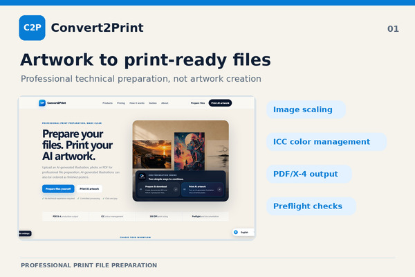
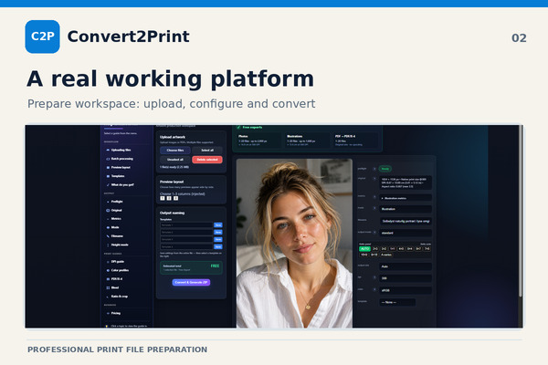

# Convert2Print
### Professional Prepress Technology & Creative Software

**Built independently in Denmark by Stefan Mäkinen.**

Convert2Print is a professional print-preparation platform built around a deterministic processing engine called the **Golden Pipeline**.

What began as a personal challenge with preparing digital artwork for printing has grown into an operational prepress system and a foundation for new professional creative tools.

---
## See Convert2Print in Action

Convert2Print is an operational platform for professional print preparation.

### Watch the Video Demonstration

See the operational Convert2Print platform in action,
powered by the deterministic Golden Pipeline.

[▶ Watch the Convert2Print Video Demonstration](https://github.com/convert2print/convert2print-community/discussions/3)

---
## The Golden Pipeline

The Golden Pipeline is a modular, non-AI processing engine designed to prepare artwork for professional printing through predictable, technically controlled workflows.

**Core capabilities include:**

- High-resolution image scaling and batch processing
- Professional ICC color management and RGB-to-CMYK conversion
- Print-ready JPG and PDF/X-4 generation
- Technical preflight checks for PDF structure, OutputIntent, ICC profiles and total area coverage (TAC)
- Resolution, scaling and page-box validation
- Delta E colour-difference analysis and quality reports

The technology has undergone extensive file testing, PDF/X-4 validation and physical print production. The processing engine operates independently of the product interfaces built around it.

## Creative Studio — In Development

Convert2Print Creative Studio is being developed as a **free professional workspace for registered digital creators and creative businesses**.

The goal is to bring artwork libraries, project management, professional file preparation, multi-size digital exports, mockups and other creative tools into one workspace.

Creative Studio is designed to use the existing Golden Pipeline rather than duplicate the underlying processing technology.

The planned business model explores voluntary support, industry partnerships and separate commercial B2B solutions without mandatory Creative Studio subscriptions.

## International Press Coverage

Convert2Print has received coverage from international printing and technology publications, including:

- **WhatTheyThink** — United States
- **PRINTmatters** — Netherlands
- **INKISH** — International
- **KrispiTech** — United States
- **PrintInsider** — Russian-language publication

[Explore the press coverage and articles](https://github.com/convert2print/convert2print-community/discussions/2)

## Explore the Project

- [Official Website](https://convert2print.com)
- [GitHub Community](https://github.com/convert2print/convert2print-community)
- [Public Development Roadmap](https://github.com/users/convert2print/projects/1)
- [Community Discussions](https://github.com/convert2print/convert2print-community/discussions)

---

**One processing engine. Multiple professional workflows.**

*Developed independently in Denmark.*
